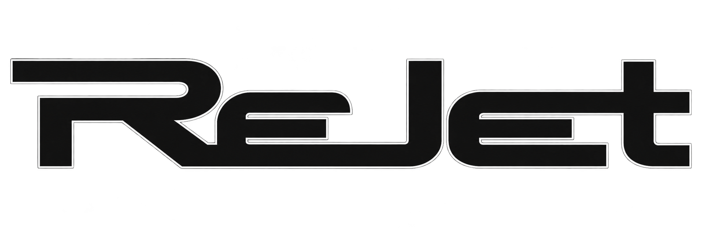

<p align="center"></p>

<p align="center"><b>Jet Set Radio Future, native on Windows, from your own disc, with modern enhancements.</b></p>

ReJet runs the original Xbox game *Jet Set Radio Future* (Smilebit / Sega, 2002) as a Windows program: no emulator. A loader maps the game's own `default.xbe` into memory, provides the Xbox kernel itself, and replaces the Xbox system libraries (Direct3D 8, DirectSound, the controller library) with their PC equivalents (Direct3D 9Ex, XAudio2, XInput). The game's own code runs unchanged; enhancements hook specific parts of it, each one a setting with the original behaviour available.

> **Status: alpha.** The game boots, runs at a steady 60 fps with music and sound, and is playable with a controller or keyboard; it has mostly been tested in the opening chapters. Expect bugs: see [Known issues](#known-issues-and-limitations), and please [report what you find](#reporting-bugs).

- **No game data is included.** You need your own copy of the game (a disc image of the PAL Xbox release). ReJet checks the files against the version it supports before using them.
- **Not affiliated** with Sega, Smilebit, Microsoft or any rights holder. *Jet Set Radio Future* and *Jet Set Radio* are trademarks of their owners.
- **Independent work:** ReJet doesn't use code from any other Jet Set Radio Future decompilation or port. It is a sister project of ReWhacked (the same approach, applied to *Whacked!*).

## Screenshots

| | |
|---|---|
|  |  |
|  |  |
|  |  |

## Features

**Runs natively**
- The original game code on Windows 10/11, without an emulator; 60 fps (the PAL game always runs in its 60 Hz mode).
- Controllers through XInput (Xbox and compatible pads), or the keyboard.
- Saves are kept between sessions (in `%LOCALAPPDATA%\rejet`).

**Enhancements** (all in the in-game ReJet menu, all live, all remembered)
- **Any resolution**: 480 to 2160 lines (the Xbox drew 640x480).
- **Widescreen (Hor+)**: 16:10, 16:9 and 21:9 show more of the world at the sides with the same vertical view; the game's culling is widened too, so the edges aren't empty. 2D (HUD, menus, speech bubbles) keeps its 4:3 proportions in the middle of the screen.
- **Borderless full screen**, a freely sized window, sharp on scaled (high-DPI) displays.
- **Anisotropic texture filtering** (up to 16x).
- **Cleaner 2D at high resolutions**: no dark seams or stray lines around text boxes and menus that only show up above 640x480.
- **Volume**, mute in the background, an FPS counter, VSync.

**Made for testing**
- The **ReJet menu** (F1, or Back + Start on a controller) pauses the game; **Report a bug** saves a capture of the moment with your note.
- Xbox button icons in the menu when a controller is connected.
- F12 screenshots, F11 bug captures, F10 log markers, each confirmed on screen.

The full list, done and planned: [docs/ENHANCEMENTS.md](docs/ENHANCEMENTS.md).

## Getting started

**You need**
- Windows 10 or 11 (64-bit), a Direct3D 9-capable graphics card (anything from the last 15 years), about 2.5 GB of disk space.
- Your own disc image of **Jet Set Radio Future, PAL Xbox release** (title ID 49470018), as an `.iso` (a trimmed XISO or a full image), or a folder you've already extracted it to. Other regions (NTSC-U, NTSC-J) aren't supported yet.

**Install**
1. Download the latest release and unzip it anywhere (or [build it yourself](#building-from-source)). It contains `ReJet.exe` and `rejet.dll`.
2. Run `ReJet.exe`. The first time, ReJet asks for your game: choose your disc image (it is checked and extracted into a `Game` folder next to ReJet, with a progress bar) or your extracted folder.
3. Play. The ReJet menu (**F1**, or **Back + Start** on a controller) has the display and audio settings.

To use other game files later: ReJet menu → Game → *Choose other game files* (asked at the next start).

**Controls**

| Game | Controller | Keyboard |
|---|---|---|
| Move | Left stick | W A S D |
| Jump (A) | A | Space or Z |
| Boost, spray (B) | B | X |
| X / Y | X / Y | C / V |
| Triggers (camera, trick) | LT / RT | Q / E |
| Start / Back | Start / Back | Enter / Backspace |
| ReJet menu | Back + Start | F1 |
| Screenshot / bug capture / log marker | | F12 / F11 / F10 |

## Known issues and limitations

- **PAL release only** for now; other regions need their own address maps.
- The **player's ground shadow** is missing (environment shadows work).
- The **boost effect** works but isn't an exact match for the Xbox (slightly darker, a different blur).
- Some **flickering dark patches** on grind rails in the intro fly-through, and a large flat white shape in one shot of it.
- In widescreen the HUD sits in the middle 4:3 area rather than at the screen edges.
- 60 fps only: the game's logic advances once per frame (see [docs/HIGH_FRAME_RATE.md](docs/HIGH_FRAME_RATE.md)).
- Mostly tested in the opening chapters; later stages, multiplayer (local split screen) and the custom soundtrack feature are untested.
- The game is paused while the ReJet menu is open, so F12 doesn't take screenshots there.

The current list is in [docs/KNOWN_BUGS.md](docs/KNOWN_BUGS.md).

## Reporting bugs

Open the ReJet menu where the problem is (F1, or Back + Start), choose **Report a bug**, pick what went wrong and type a note. ReJet saves a capture of that moment in `captures\` next to `ReJet.exe`. Open an issue describing what happened, and attach that capture folder (zipped) and `loader.log`. More detail: [docs/TESTING.md](docs/TESTING.md).

## Building from source

Requirements: Visual Studio with **Desktop development with C++** (tested with Visual Studio 2026; it builds a 32-bit x86 program, found automatically) and Python 3 (code generation at build time).

```
tools\loader\build.bat
```

This writes `build\loader\ReJet.exe` and `rejet.dll`. Run `ReJet.exe` from there (first-run setup as above), or for development pass the game directly: `ReJet.exe <path to default.xbe> [seconds, 0 = until closed]`; `play.bat` runs the build (with the same arguments, if any). Debugging switches (scripted input, screenshots every n frames, captures at a frame, traces) are listed in [docs/TESTING.md](docs/TESTING.md).

**Repository layout**

```
loader/       ReJet.exe (address-space stub) and rejet.dll: XBE mapper, Xbox kernel, Direct3D / DirectSound /
              controller replacements, the ReJet menu and first-run setup
tools/        disc and XBE readers, build and code generation, Ghidra headless scripts
config/       hashes of the supported disc and XBE, function inventory, kernel imports
include/xbox/ clean-room Xbox declarations
docs/         progress log, subsystem map, enhancements, known bugs, testing guide
```

## Versions

ReJet uses [semantic versioning](https://semver.org/) (`MAJOR.MINOR.PATCH`, in the `VERSION` file); while it is below 1.0 any release may change things. Each build also records its git commit: the ReJet menu (bottom right), the setup screen, the first line of `loader.log`, every bug capture and the files' Windows properties show it, for example `0.1.0+3437d69` (`-dirty` marks a build from uncommitted code). Please include it in bug reports. Release packages are made with `python tools/make_release.py` from a clean commit.

## How it works

Xbox games are 32-bit x86 programs, like Windows programs. ReJet's tiny `ReJet.exe` reserves the address range the game expects; `rejet.dll` loads `default.xbe` there, gives the game its own implementation of the Xbox kernel (threads, files, memory, timers), and patches the game's copies of the Xbox system libraries to jump to PC replacements: Direct3D 8 calls become Direct3D 9Ex (with the Xbox GPU's vertex programs and register combiners translated to shaders), DirectSound becomes a software mixer over XAudio2, and controller polling becomes XInput. Enhancements such as widescreen hook the game's renderer at specific, documented addresses ([docs/SUBSYSTEMS.md](docs/SUBSYSTEMS.md)). The development log is [docs/PROGRESS.md](docs/PROGRESS.md).

## Credits and acknowledgements

- **Jet Set Radio Future** by Smilebit, published by Sega (2002). Please support the official releases.
- **ReWhacked**, ReJet's sister project, which proved the approach.
- Tools: [Ghidra](https://github.com/NationalSecurityAgency/ghidra) (NSA), [ghidra-xbe](https://github.com/XboxDev/ghidra-xbe) and the [XbSymbolDatabase](https://github.com/Cxbx-Reloaded/XbSymbolDatabase) it uses to name Xbox library functions, [Capstone](https://www.capstone-engine.org/), Visual Studio and the DirectX runtime from Microsoft.
- The Xbox homebrew and preservation community's public documentation of the Xbox's formats and hardware.
- ReJet logo: the project's author.
- **AI use:** most of the code and notes were written with [Claude Code](https://claude.com/claude-code) (Anthropic) under human direction, review and play testing.
