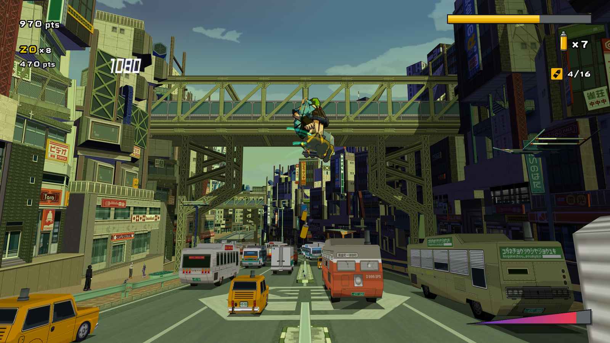
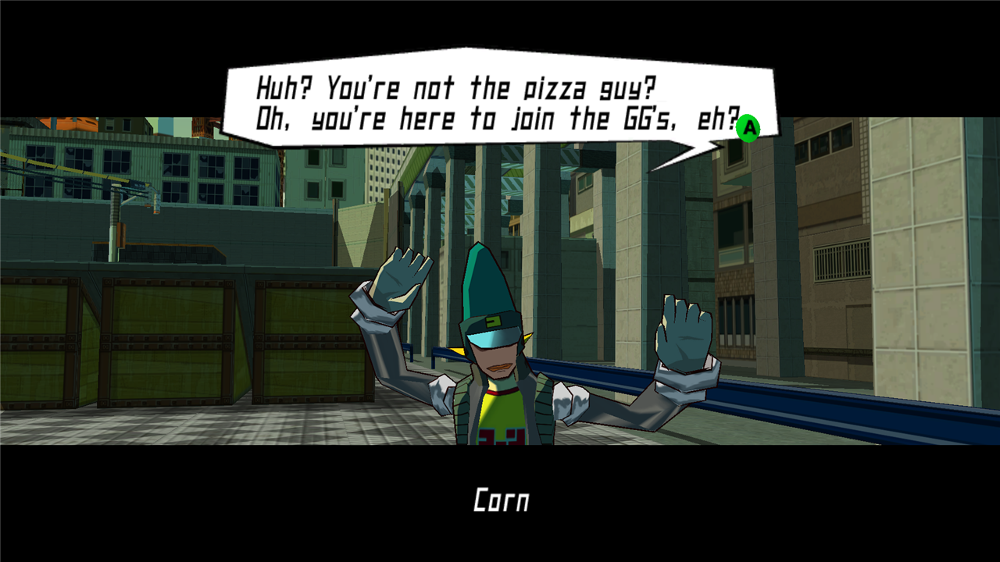
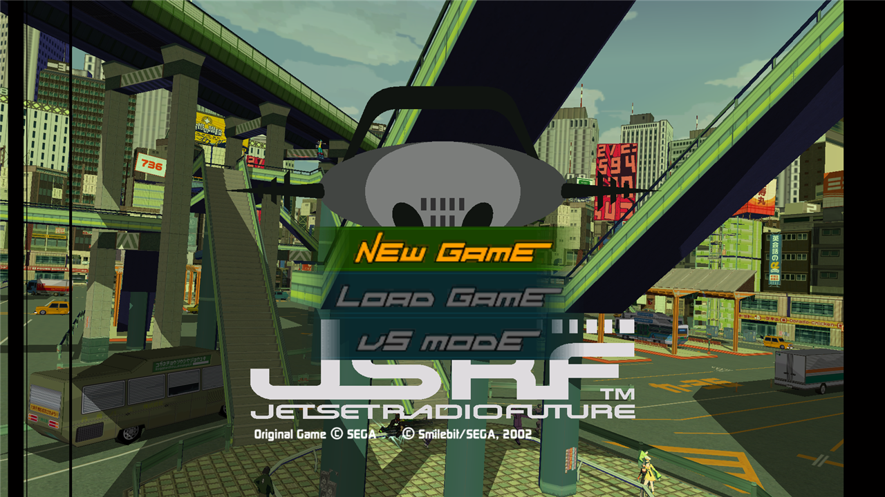
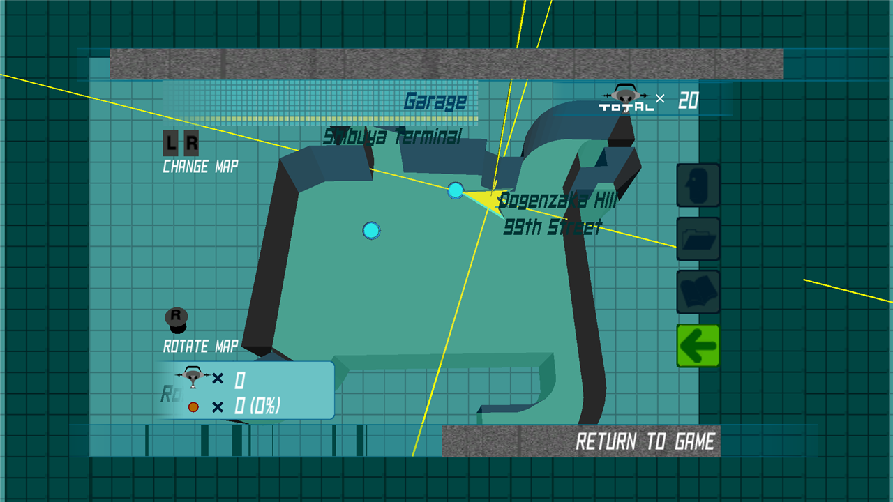
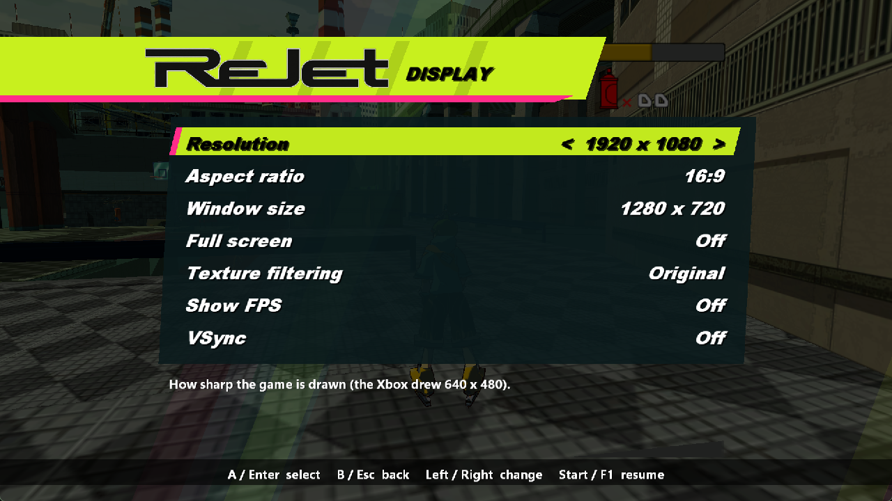
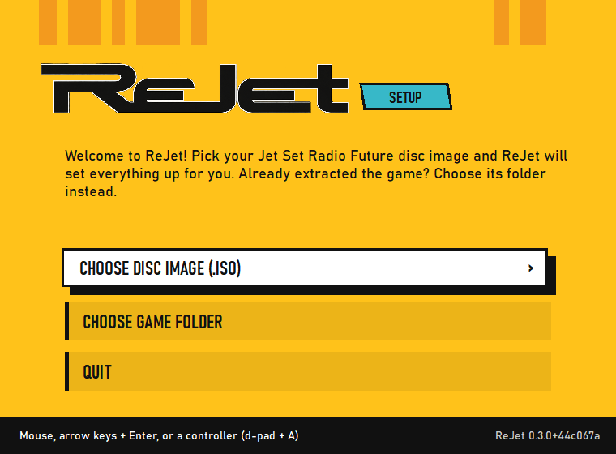

<p align="center"></p>

<p align="center"><b>Jet Set Radio Future on your PC, from your own disc, with a few modern upgrades.</b></p>

---

Jet Set Radio Future never got a PC release. ReJet lets you play your own Xbox copy natively on Windows, at any resolution, in widescreen, with a controller or keyboard, without an emulator.

It works a bit like a translator. Xbox games are 32-bit x86 programs, just like Windows programs, so ReJet loads the game's original code as it is and swaps out the parts that only exist on an Xbox (the graphics chip, the sound hardware, the controllers) for their PC equivalents. The game itself doesn't know the difference. Anything ReJet adds, like widescreen, is a setting you can turn off to get the original back.

> **ReJet is in alpha.** It boots, plays smoothly at 60 fps with music and sound, and the opening chapters have been played through, but you'll find bugs. If you do, please [tell us about them](#found-a-bug): that's the most useful thing you can do right now.

## Screenshots

| | |
|---|---|
|  |  |
|  |  |
|  |  |

## What you need

- **Windows 10 or 11** (64-bit) and pretty much any graphics card from the last 15 years.
- **About 2.5 GB** of free space.
- **Your own copy of Jet Set Radio Future**, as a disc image (`.iso`) or a folder you've already extracted it to. ReJet doesn't include any part of the game, and never will.

### Which version of the game?

Right now ReJet supports **one version: the European (PAL) Xbox release** of Jet Set Radio Future, the disc sold in Europe and Australia with PAL on the case. The US (NTSC) and Japanese releases lay their game code out differently, so each needs its own support; that's planned but not done yet.

You don't need to work out which version you have: ReJet checks your disc image when you set it up and tells you if it isn't the one it supports. Both trimmed and full-size disc images work.

## Getting started

1. Download the latest release from the [Releases](../../releases) page and unzip it somewhere you can write to, like your Documents folder.
2. Run **ReJet.exe**.
3. The first time, ReJet asks for your game. Pick your disc image and it copies the game files into a `Game` folder next to ReJet (you'll see a progress bar), or pick a folder where you've already extracted the game.
4. That's it. From then on, ReJet.exe goes straight into the game.

Your saves and settings are kept between sessions.

### Controls

| | Controller | Keyboard |
|---|---|---|
| Move | Left stick | W A S D |
| Jump | A | Space or Z |
| Boost and spray | B | X |
| X / Y | X / Y | C / V |
| Triggers | LT / RT | Q / E |
| Start / Back | Start / Back | Enter / Backspace |
| **ReJet menu** | **Back + Start** | **F1** |
| Full screen on or off | | Alt + Enter |

## The ReJet menu

Press **F1**, or **Back and Start together** on a controller, at any time. The game pauses and the ReJet menu slides in. It works with a controller (with proper button icons) or the keyboard, and everything you change is saved straight away.

## What's new compared with the Xbox

- **Any resolution**, up to 4K: much sharper than the Xbox's 640×480, changed live from the menu.
- **Widescreen** in 16:10, 16:9 or 21:9. You see more of the city at the sides rather than a stretched picture, and the HUD keeps its proper shape.
- **Full screen or a window**, at whatever size you like, sharp on high-DPI screens.
- **Anti-aliasing** (2x, 4x or 8x MSAA) for smooth edges on the outlines and the city.
- **Sharper textures** with anisotropic filtering (great on floors and roads at an angle).
- **Cleaner 2D**: no dark fringes or stray lines around text and menus at high resolutions.
- **Volume control**, mute while you're in another window, an FPS counter, VSync.
- **Smooth frame pacing**: on 60, 120 and 240 Hz displays every frame lines up with the screen's refresh, so motion stays even.
- **Always 60 Hz**: the European disc's 50 Hz mode is gone, so the game always runs at full speed.
- **First-time setup** that finds and checks your game for you.
- **Built-in bug reporting**: one menu option saves everything needed to look into a problem.

## What's planned

- **HUD at the screen edges in widescreen** (it currently stays in the middle 4:3 area).
- **Right-stick camera control** and **button remapping**.
- **Your own music**: the Xbox let Jet Set Radio Future play songs from its hard drive, and ReJet could map that to a folder on your PC.
- **Skipping the intro logos**, and controller rumble on/off.
- **The US and Japanese releases** of the game.
- Further out: HD texture packs, and an experimental smooth-motion mode for high-refresh monitors. The game's logic runs at exactly 60 updates a second, so going above 60 fps means generating in-between frames; [here's why](docs/HIGH_FRAME_RATE.md).

The full list lives in [docs/ENHANCEMENTS.md](docs/ENHANCEMENTS.md).

## Known issues

- The player's shadow on the ground is missing (shadows on the environment are fine).
- The boost effect looks a little darker than on the Xbox.
- A few flickering dark patches on grind rails in the intro fly-through.
- Mostly tested in the first part of the game; later levels, local multiplayer and custom soundtracks haven't been tried yet.
- 60 fps only, as on the Xbox.

The current list is in [docs/KNOWN_BUGS.md](docs/KNOWN_BUGS.md).

## Found a bug?

Thank you! ReJet can gather everything for you:

1. While the problem is on screen, open the ReJet menu (F1, or Back + Start) and choose **Report a bug**. Pick what went wrong and add a short note if you like.
2. ReJet saves a folder in `captures\` next to `ReJet.exe`. Zip it up (right-click it, then *Send to* → *Compressed (zipped) folder*).
3. [Open an issue](../../issues/new/choose) and drag in the zip and `loader.log` from the ReJet folder.

If ReJet crashed or froze, just attach `loader.log`. Every log and capture records which ReJet version made it.

## Building it yourself

You'll need Visual Studio (2026 is what's tested) with **Desktop development with C++**, and Python 3. Then run:

```
tools\loader\build.bat
```

That puts `ReJet.exe` and `rejet.dll` in `build\loader`. Developers can also pass the game directly (`ReJet.exe <path to default.xbe> [seconds]`); the testing switches (scripted input, screenshots, captures) are in [docs/TESTING.md](docs/TESTING.md). How the pieces fit together is in [docs/SUBSYSTEMS.md](docs/SUBSYSTEMS.md), and the day-by-day story is in [docs/PROGRESS.md](docs/PROGRESS.md).

Versions follow [semantic versioning](https://semver.org/) (the `VERSION` file); release zips are made with `python tools/make_release.py` from a committed tree.

## The fine print

- ReJet is a fan project and isn't affiliated with or endorsed by Sega, Smilebit or Microsoft. *Jet Set Radio Future* and *Jet Set Radio* are trademarks of their owners. Please support official releases.
- ReJet contains no game code or assets. You need your own copy of the game, and ReJet checks it before using it.
- ReJet was written independently; it doesn't use code from any other Jet Set Radio Future decompilation or port.
- Most of ReJet's code and notes were written with [Claude Code](https://claude.com/claude-code) (Anthropic), with a human directing, reviewing and play testing.

## Licence

ReJet is free software under the [GNU General Public License v3.0](LICENSE): you can use, share and change it, and if you share a modified version, you share its source code under the same licence too. The licence covers ReJet's own code and files only, never the game.

## Thanks

- **Smilebit and Sega**, for Jet Set Radio Future.
- **ReWhacked**, ReJet's sister project, which proved this approach on *Whacked!*.
- The tools that made the research possible: [Ghidra](https://github.com/NationalSecurityAgency/ghidra), [ghidra-xbe](https://github.com/XboxDev/ghidra-xbe) and the [XbSymbolDatabase](https://github.com/Cxbx-Reloaded/XbSymbolDatabase) it uses, and [Capstone](https://www.capstone-engine.org/).
- The Xbox homebrew and preservation community, for documenting the console in public.
